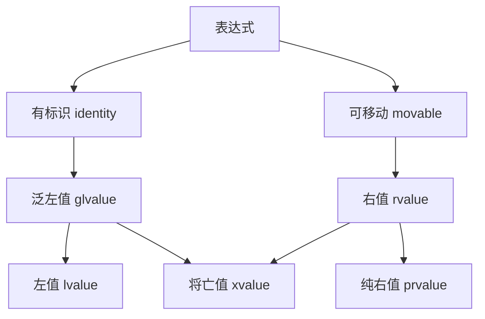

---
title: 程序体积优化规范 (C++)
date: 2026-11-07
tags: [优化]
category: 技术笔记
series: C++
order: 1
summary: 从内存对齐、位域、移动语义到编译期优化，全面总结 C++ 程序体积与运行效率的瘦身指南。
---

## 一、结构体/类内存优化

### 1. 内存对齐与填充

编译器为了对齐会在成员间插入填充字节。

```cpp
// 糟糕的例子 - 可能占用 24 字节
struct BadStruct {
    bool a;         // 1 byte + 7 padding
    double b;       // 8 bytes  
    int c;          // 4 bytes + 4 padding
    char d;         // 1 byte + 7 padding
}; 
```


```cpp
// 优化的例子 - 可能只占用 16 字节  
struct GoodStruct {
    double b;       // 8 bytes
    int c;          // 4 bytes
    bool a;         // 1 byte
    char d;         // 1 byte + 2 padding
};
```


**优化技巧：**
- 按成员大小降序排列（大的基本类型在前）。
- 使用 `#pragma pack(1)` 谨慎地取消对齐（可能影响性能）。

```cpp
#pragma pack(push, 1)  // 保存当前对齐，设置为1字节对齐
struct TightPacked {
    char a;   //1 bytes + 3 padding(当前情况下没有此填充字节)
    int b;    // 4 bytes 现在不对齐到4字节边界
    double c; // 8 bytes 也不对齐到8字节边界
};
#pragma pack(pop)     // 恢复原有对齐

/* 使用这个函数计算出实际空间占用 */
template<typename T, typename... Args>
void Sizeof(T first, Args... args) {
    cout << "类型: " << typeid(first).name() 
         << ", 大小: " << sizeof(first) << endl;
    
    if constexpr (sizeof...(args) > 0) {
        Sizeof(args...);
    }
}

/*实际输出：
类型: struct BadStruct, 大小: 24
类型: struct GoodStruct, 大小: 16
类型: struct TightPacked, 大小: 13
*/
```

使用 `alignas` 指定对齐方式(SIMD向量优化)。

### 2. 位域

当数据范围很小时，使用位域节省空间：

```cpp
struct CompactFlags {
    unsigned int is_visible : 1;    // 1 bit
    unsigned int is_active : 1;     // 1 bit  
    unsigned int type : 3;          // 3 bits (0-7)
    unsigned int priority : 4;      // 4 bits (0-15)
    // 总共 9 bits，实际占用 4 bytes
};
```

### 3. 共用体 (Union)

```cpp
union VariantData {
    int int_value;
    float float_value;
    char string_value[16];
    // 只占用 16 字节，而不是 4+4+16=24 字节
};

struct TaggedVariant {
    enum Type { INT, FLOAT, STRING } type;
    VariantData data;  // 根据 type 决定如何解释 data
};
```

---

## 二、函数优化

### 1. 参数传递优化

```cpp
// 不佳 - 不必要的拷贝
void processVector(std::vector<int> data) {
    // data 是副本
}

// 良好 - 常量引用避免拷贝(左值)
void processVector(const std::vector<int>& data) {
    // 只读访问
}

// 最佳 - 需要修改且要避免拷贝时使用移动(右值)
void consumeVector(std::vector<int>&& data) {
    // 取得所有权，零拷贝
}
```



| 类别 | 英文名 | 中文名 | 特征 | 例子 |
|------|--------|--------|------|------|
| lvalue | lvalue | 左值 | 有名字，有地址，生命周期明确 | 变量, 引用 |
| prvalue | pure rvalue | 纯右值 | 临时值，无地址，不能取地址 | 字面量, 临时对象 |
| xvalue | expiring value | 将亡值 | 可安全移动资源的左值 | std::move(result) |

### 2. 内联函数

```cpp
// 头文件中定义，建议内联
inline int square(int x) {
    return x * x;
}

// C++17 的 constexpr 函数在编译期求值
constexpr int compileTimeSquare(int x) {
    return x * x;
}

// 使用场景
int array[compileTimeSquare(5)]; // 编译期确定大小
```

### 3. 返回值优化

```cpp
// 编译器会优化掉拷贝
std::vector<int> createVector() {
    std::vector<int> result;
    // ... 填充数据
    return result; // 不会发生拷贝 (NRVO)
}
```

---

## 三、数据结构和算法优化

### 1. 选择合适的数据结构

```cpp
// 场景：需要快速查找，不关心顺序
std::unordered_map<Key, Value> fast_lookup;  // O(1)
std::map<Key, Value> sorted_lookup;          // O(log n)

// 场景：大量插入删除，主要在首尾
std::deque<int> better_than_vector;  // 首尾操作 O(1)

// 场景：只需要存布尔值
std::vector<bool> packed_bits;       // 每个bool用1bit
std::bitset<1000> fixed_size_bits;   // 编译期固定大小
```

### 2. 预分配内存

```cpp
std::vector<int> vec;
vec.reserve(1000);  // 预分配，避免多次扩容

// 对于字符串
std::string str;
str.reserve(1024);  // 预分配足够空间
```

### 3. 使用栈内存替代堆内存

```cpp
// 堆分配 - 较慢
int* heap_array = new int[100];

// 栈分配 - 快速，自动管理
int stack_array[100];

// 或者使用 std::array
std::array<int, 100> modern_array;
```

---

## 四、编译期优化

### 1. 常量表达式

```cpp
constexpr int MAX_SIZE = 100;  // 编译期常量

// C++20 的 consteval
consteval int strictCompileTime(int x) {
    return x * x;  // 必须在编译期求值
}
```

### 2. 类型萃取与分支

```cpp
template<typename T>
constexpr bool is_small_type = sizeof(T) <= 8;

// 根据类型大小选择不同实现
template<typename T>
void process(const T& value) {
    if constexpr (is_small_type<T>) {
        // 小类型的优化实现
        processSmall(value);
    } else {
        // 大类型的通用实现
        processLarge(value);
    }
}
```

---

## 五、运行时内存管理

### 1. 内存池

对于频繁创建销毁的小对象：

```cpp
class ObjectPool {
private:
    std::vector<std::unique_ptr<char[]>> blocks;
    std::stack<void*> free_list;
    
public:
    void* allocate(size_t size);
    void deallocate(void* ptr);
};

// 使用内存池避免频繁的 new/delete
```

### 2. 字符串优化

```cpp
// 小字符串优化 - 大多数实现都有
std::string small = "hi";    // 可能存储在栈上
std::string large = "这是一个很长的字符串..."; // 存储在堆上

// 字符串视图避免拷贝
void processString(std::string_view str) {  // 零拷贝(本质上是安全的指针)
    // 只读访问
}
```

---

## 六、工具和实践

### 1. 分析工具

```bash
# 查看内存使用
valgrind --tool=massif ./your_program

# 查看二进制大小  
size ./your_program

# 分析符号表
nm --size-sort ./your_program | c++filt
```

### 2. 编译器选项

```bash
# 大小优化
g++ -Os -s main.cpp

# 链接时优化
g++ -flto main.cpp

# 去除调试符号
strip ./your_program

# 静态链接库优化
g++ -static -Wl,--gc-sections main.cpp
```

### 3. 实际测量

```cpp
#include <chrono>
#include <iostream>

class MemoryTracker {
    static inline size_t total_allocated = 0;
public:
    static void* allocate(size_t size) {
        total_allocated += size;
        std::cout << "Allocated: " << size << " bytes, Total: " 
                  << total_allocated << " bytes\n";
        return malloc(size);
    }
    
    static void deallocate(void* ptr, size_t size) {
        total_allocated -= size;
        std::cout << "Freed: " << size << " bytes, Total: " 
                  << total_allocated << " bytes\n";
        free(ptr);
    }
};
```

---

## 七、高级技巧

### 1. 类型擦除

```cpp
class AnyCallable {
    struct Base {
        virtual ~Base() = default;
        virtual void call() = 0;
    };
    
    template<typename T>
    struct Impl : Base {
        T func;
        Impl(T&& f) : func(std::forward<T>(f)) {}
        void call() override { func(); }
    };
    
    std::unique_ptr<Base> pimpl;
    
public:
    template<typename T>
    AnyCallable(T&& func) : pimpl(std::make_unique<Impl<T>>(std::forward<T>(func))) {}
    
    void operator()() { pimpl->call(); }
};
// 大小 = sizeof(unique_ptr)，
// 无论实际可调用对象多大
```

### 2. 压缩数据结构

```cpp
// 存储大量小整数时
class PackedIntArray {
    std::vector<uint32_t> data;
    int bits_per_element;
    
public:
    PackedIntArray(int max_value) {
        bits_per_element = std::bit_width(static_cast<uint32_t>(max_value));
        // 使用位运算在 vector 中紧凑存储
    }
    
    void set(int index, int value) {
        // 位操作实现...
    }
    
    int get(int index) const {
        // 位操作实现...
    }
};
```